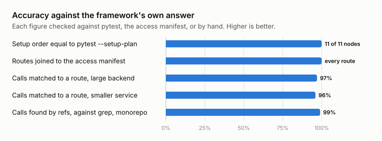
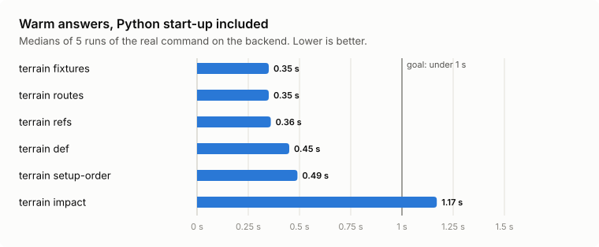
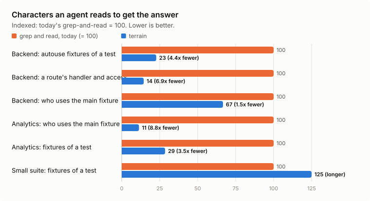
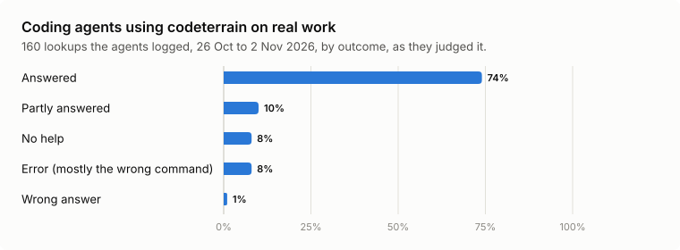
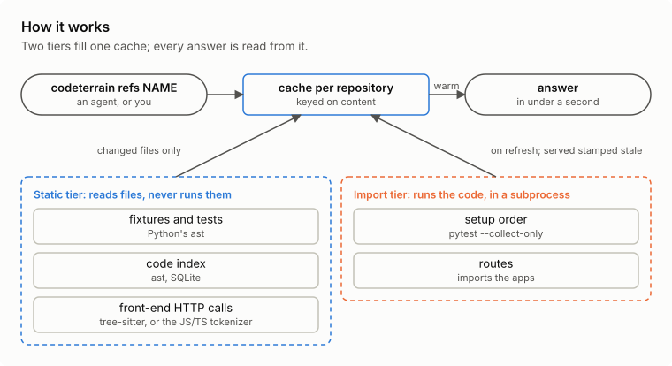

<p align="center">
  
</p>

<h1 align="center">codeterrain</h1>

<p align="center">
  <b><code>codeterrain</code>: answers about your code, in under a second.</b><br>
  For coding agents, and the people working beside them.
</p>

<p align="center">
  Local only &nbsp;·&nbsp; no LLM &nbsp;·&nbsp; no network calls of its own &nbsp;·&nbsp; Python, pytest, FastAPI &nbsp;·&nbsp; JavaScript and TypeScript front ends &nbsp;·&nbsp; Terraform
</p>

<p align="center">
  <a href="#quick-start">Quick start</a> &nbsp;·&nbsp;
  <a href="#what-it-answers">What it answers</a> &nbsp;·&nbsp;
  <a href="#results">Results</a> &nbsp;·&nbsp;
  <a href="#inferred-token-savings">Token savings</a> &nbsp;·&nbsp;
  <a href="#how-it-works">How it works</a> &nbsp;·&nbsp;
  <a href="#documentation">Docs</a>
</p>

---

A coding agent spends most of its reading on structure it has to rediscover every session: which
fixtures a test really gets, where a route is handled, who calls a function, which tests reach
it. The answers are in the code, but finding them takes rounds of grep and file reads, and a
wrong guess costs a review round.

`codeterrain` answers those questions from a cache, the way the framework itself would answer them.

| | |
|:---|:---|
| **Accurate where it counts** | Setup order and routes come from pytest and FastAPI themselves: setup order equals `pytest --setup-plan` on every node tested. `refs`, `def` and `impact` read the code statically: they follow imports and re-exports, so an alias counts and a same-named function elsewhere does not, and a name whose meaning depends on run time is left unresolved rather than guessed ([limits](https://github.com/benchli-sports/codeterrain/blob/main/docs/limits.md)). |
| **Fast** | Most warm answers take 0.3 to 0.5 s on a large backend, Python start-up included. |
| **Shorter to read** | 4.4x to 8.8x fewer characters than the grep-and-read it replaces, on code bases with a real fixture graph. That measures the answer, not a whole session's tokens, cost or time. |
| **Careful with your repo** | The static tier never runs the target's code. Setup order and routes have to import it: they run in a subprocess with an allowlisted environment, dummy cloud credentials and a best-effort network guard, which stop accidents, not hostile code. Run those two on code you trust ([SECURITY.md](https://github.com/benchli-sports/codeterrain/blob/main/SECURITY.md)). |

## Quick start

```sh
uv tool install codeterrain     # Python 3.12+; the only dependency is pluggy
# or "codeterrain[terraform]" to add the Terraform language pack, "codeterrain[typescript]"
# to read front-end calls with tree-sitter, "codeterrain[terraform,typescript]" for both
cd your-repo
codeterrain doctor              # what it found, and which config it used
codeterrain fixtures            # every pytest fixture, and which definition wins where
```

The same command is also installed as `terrain`, a shorter name. Another tool on PyPI installs a
`terrain` command too; with both installed, the last one wins, while `codeterrain` is always this
one. To work on codeterrain itself, install from a checkout instead:
`uv tool install --editable <path-to-checkout>`.

Ask about a function: where it is called, how each call passes its arguments, and which tests patch it.
This is `codeterrain` run on its own source:

```console
$ codeterrain refs is_test_module
function codeterrain.fixtures_static.is_test_module(rel)  src/codeterrain/fixtures_static.py:327
6 calls (6 in code, 0 in tests), 0 with a shape problem, 0 used as a value, 0 patched
file:line                                 in                             shape         note
src/codeterrain/code_static.py:1349       update                         1 positional
src/codeterrain/code_static.py:1357       update.<listcomp>              1 positional
src/codeterrain/fixtures_static.py:322    unlisted_test_trees.<genexpr>  1 positional
src/codeterrain/fixtures_static.py:435    build                          1 positional
src/codeterrain/impact.py:272             _Fixtures.__init__             1 positional
src/codeterrain/impact.py:424             _inherited_tests               1 positional
```

Ask which tests statically reach it, through its callers and the fixtures that call them
(abridged). A test that reaches a function does not necessarily check what you change, and an
empty list does not prove the change is untested:

```console
$ codeterrain impact is_test_module --depth 2
17 tests reach codeterrain.fixtures_static.is_test_module (0 directly), through 15 callers within 2 levels; 2 tests patch it …
test                                                 depth  how                               via
tests/test_cli.py::test_a_handler_is_matched_by_…    2      call at tests/test_cli.py:1186    …update <- …is_test_module
tests/test_cli.py::test_a_route_text_that_matches_…  2      call at tests/test_cli.py:1142    …update <- …is_test_module
…
```

Ask what a fixture is and what depends on it (from the sample repository in `tests/sample_repo`):

```console
$ codeterrain fixture db
name: db
scope: session
autouse: no
params: none
deps: _env_session
defined: tests/conftest.py:9
overrides: -

dependents (4):
fixture  mod_cache  tests/conftest.py:14  arg
fixture  _reset_state  tests/conftest.py:19  arg
fixture  client  tests/conftest.py:34  arg
…
```

The commands that import your application (`setup-order`, `routes`) run in the **target's**
interpreter: pass `--python .venv/bin/python` or set `CODETERRAIN_PYTHON`. Add `--json` to any command
for the full data.

## Telling your agent

An agent uses `codeterrain` when its instructions say when to. A starting point for `AGENTS.md` or
`CLAUDE.md`:

```markdown
## Code structure: ask codeterrain first

Before grepping or reading files for one of these, run `codeterrain` in the repository root
(local, under a second when warm; add `--json` for the full data):

- where a name is defined: `codeterrain def NAME`
- who calls, passes or patches it: `codeterrain refs NAME`
- which tests statically reach it: `codeterrain impact NAME` (a starting point, not proof of coverage)
- which fixtures a test gets, in order: `codeterrain setup-order NODEID`
- a fixture and what depends on it: `codeterrain fixture NAME`
- where a route is handled: `codeterrain route METHOD PATH`
- a front end's HTTP calls, and the backend routes they hit: `codeterrain calls`, `codeterrain callers`

When codeterrain says it cannot resolve something, fall back to grep. `setup-order` and the route
commands import the code: use them only on code you trust.
```

## What it answers

| Question | Command | What grep can't tell you |
|:---|:---|:---|
| Where is this defined? | `codeterrain def NAME` | Resolves a re-export to the real definition |
| Who calls it, passes it, patches it? | `codeterrain refs NAME` | Follows imports and aliases, flags calls that don't fit the signature, and separates tests that patch it out |
| Who imports this module, and what does it import? | `codeterrain importers MODULE`, `codeterrain imports MODULE` | Every import of it or of a name from it, relative imports resolved |
| Which tests statically reach it? | `codeterrain impact NAME` | Walks callers and fixtures the way pytest resolves them; what it cannot follow statically is listed, not dropped |
| Which fixtures does a test get, in what order? | `codeterrain setup-order NODEID` | pytest's own resolution, overrides and scopes included |
| What fixtures exist, and who uses one? | `codeterrain fixtures`, `codeterrain fixture NAME` | Which definition wins where, and every dependent |
| Where is a route handled, with what access? | `codeterrain routes`, `codeterrain route METHOD PATH` | Prefixes from router calls in other files, joined to your access manifest |
| Which HTTP calls does a front end make? | `codeterrain calls` | Paths built from templates, constants and concatenation |
| Which backend route does each call hit? | `codeterrain callers` | Front-end calls matched to backend routes across repositories |
| Where is a Terraform resource, variable or module, and who reads it? | `codeterrain def NAME`, `codeterrain refs NAME` (Terraform pack) | Terraform's own names (`aws_s3_bucket.logs`, `var.region`, `module.vpc`) and the block each reference sits in |
| What is the module tree, and which providers are pinned? | `codeterrain def --kind module`, `codeterrain def --kind required_provider` | Every module call with its source and version; provider aliases and what selects them |

Every option is in **[docs/commands.md](https://github.com/benchli-sports/codeterrain/blob/main/docs/commands.md)**.

## Results

Measured read-only on real code bases: a large FastAPI backend with a very large test suite, three
smaller Python code bases, an analytics project with a large fixture graph, and five front ends.

<table>
<tr>
<td align="center" width="25%"><h2>11 / 11</h2>test nodes where setup order equals <code>pytest --setup-plan</code></td>
<td align="center" width="25%"><h2>0.35 s</h2>median warm <code>fixtures</code> answer on the large backend</td>
<td align="center" width="25%"><h2>up to 8.8x</h2>fewer characters for an agent to read</td>
<td align="center" width="25%"><h2>160</h2>field lookups logged by coding agents; agent-assessed, not independently validated</td>
</tr>
</table>

<picture>
  <source media="(prefers-color-scheme: dark)" srcset="https://raw.githubusercontent.com/benchli-sports/codeterrain/main/docs/img/accuracy-dark.svg">
  
</picture>

<picture>
  <source media="(prefers-color-scheme: dark)" srcset="https://raw.githubusercontent.com/benchli-sports/codeterrain/main/docs/img/speed-dark.svg">
  
</picture>

`impact` is the one answer over a second: it walks callers and fixtures, and on the backend a heavily
tested function is reached by about a thousand tests. A cold build costs seconds for the static index
and about a minute and a half for the routes. After that, answers come from the cache, and a view is
stamped stale when files change.

<picture>
  <source media="(prefers-color-scheme: dark)" srcset="https://raw.githubusercontent.com/benchli-sports/codeterrain/main/docs/img/tokens-dark.svg">
  
</picture>

**The saving scales with the code.** Where the fixture graph is large, an answer is a small fraction
of the grep-and-read it replaces. In a small suite with a couple of fixtures the answer can be longer
than the grep; there the gain is the exact order, which grep can't show.

### In the field

Coding agents working on real tasks logged each `codeterrain` lookup: what they asked, whether the answer
was right, and what they would have done instead. 160 lookups, 26 October to 2 November 2026, across
the code bases above. Each agent judged its own answer against what it then read or ran; nobody
checked the judgements independently. Every lookup has one outcome; the shares are rounded, so they
can add up to 101%.

<picture>
  <source media="(prefers-color-scheme: dark)" srcset="https://raw.githubusercontent.com/benchli-sports/codeterrain/main/docs/img/field-dark.svg">
  
</picture>

- Each fully answered lookup saved the agent **about 1.8 tool calls**, by its own count.
- **Two answers were marked wrong.** In one, `fixture` answered a fixture of a live-test folder it
  did not read with a unit-test fixture of the same name; `fixtures`, `fixture` and `doctor` now name
  such a folder. The other, `routes` missing an app's support routes, was misjudged: a later lookup
  found them in the view, below the token budget's cut, whose "more" notice a `grep` had removed.
- The partial answers came mostly from output cut by the token budget; the rest from a cache built
  from a different checkout than the one being edited, reads `refs` does not see (through a module
  alias, as a dict key), duck-typed calls, and route filters that matched less than expected.
- Most errors were the wrong command or arguments: `callers`, which is for routes, where `refs` was
  meant.

## Inferred token savings

An estimate from the two measurements above, not an A/B experiment:

| Step | Figure |
|:---|---:|
| Reading saved on a question `codeterrain` answers, large backend (4.4x to 6.9x fewer characters) | 77% to 86% |
| Lookups answered fully, in the field | 74% |
| Lookups answered partly (counted at half the saving) | 10% |
| **Inferred share of lookup reading saved on a large Python backend** | **about 61% to 68%** |

Lookups are only part of a session: reasoning, editing and test runs are untouched, and small code
bases save little. Tokens here are characters divided by four. A session-level A/B, the same lane run
with and without `codeterrain`, is the next measurement. The method and the per-repository results are in
[docs/why-codeterrain.md](https://github.com/benchli-sports/codeterrain/blob/main/docs/why-codeterrain.md).

## How it works

<picture>
  <source media="(prefers-color-scheme: dark)" srcset="https://raw.githubusercontent.com/benchli-sports/codeterrain/main/docs/img/architecture-dark.svg">
  
</picture>

- **The static tier** reads source with Python's `ast`, and front-end files with tree-sitter when the
  TypeScript pack is installed (chosen for speed and accuracy) or a tokenizer written in Python when
  it is not. It never imports or runs the target, and re-reads only the files that changed.
- **The import tier** needs the real framework: pytest's fixture resolution, FastAPI's route table. It
  runs in a subprocess using the target's own interpreter, with an allowlisted environment, dummy cloud
  credentials, no proxy and a best-effort network guard. Those stop accidents, not hostile code: it
  imports and runs the target, so use it on code you trust.
- **The cache** lives outside the checkout, in the git common directory or your user cache, and is
  keyed on content hashes.

More in [docs/how-it-works.md](https://github.com/benchli-sports/codeterrain/blob/main/docs/how-it-works.md), [docs/sandbox.md](https://github.com/benchli-sports/codeterrain/blob/main/docs/sandbox.md) and
[SECURITY.md](https://github.com/benchli-sports/codeterrain/blob/main/SECURITY.md).

## Why this exists

codeterrain started inside [benchli](https://www.benchli.com), the team sports platform built by Mitbolas GmbH. Its Python backend
is a large FastAPI service with a very large test suite, developed with coding agents. Most of the
agents' tokens went on re-mapping the same structure every session, and a hand-kept map went stale
within weeks. The goal became exact answers, straight from the code, locally and in under a second, in
every repository benchli and Mitbolas develop with agents. The full story, and why we did not adopt a
knowledge-graph tool, are in [docs/why-codeterrain.md](https://github.com/benchli-sports/codeterrain/blob/main/docs/why-codeterrain.md).

## Documentation

| | |
|:---|:---|
| [Commands](https://github.com/benchli-sports/codeterrain/blob/main/docs/commands.md) | Every command, option and output |
| [Configuration](https://github.com/benchli-sports/codeterrain/blob/main/docs/configuration.md) | Precedence, every key with its default, monorepos and non-default layouts |
| [How it works](https://github.com/benchli-sports/codeterrain/blob/main/docs/how-it-works.md) | The two tiers, the cache, extractor programs |
| [The sandbox](https://github.com/benchli-sports/codeterrain/blob/main/docs/sandbox.md) | What the import tier runs with, and every gap in the network guard |
| [Limits](https://github.com/benchli-sports/codeterrain/blob/main/docs/limits.md) | What a static walk does not see, and the bounds set on purpose |
| [Security](https://github.com/benchli-sports/codeterrain/blob/main/SECURITY.md) | The trust model: what is guaranteed and what is best-effort |
| [Extractor protocol](https://github.com/benchli-sports/codeterrain/blob/main/docs/extractor-protocol.md) | Writing an extractor or a language pack for another language or framework |
| [Terraform pack](https://github.com/benchli-sports/codeterrain/blob/main/packages/codeterrain-terraform/README.md) | `.tf` files in `def` and `refs`: resources, modules, providers |
| [TypeScript pack](https://github.com/benchli-sports/codeterrain/blob/main/packages/codeterrain-typescript/README.md) | Front-end calls read with tree-sitter, and why it is the reader to install |
| [Design notes](https://github.com/benchli-sports/codeterrain/blob/main/docs/design-v0.2.md) | The decisions behind the front-end calls and the language packs |
| [Why codeterrain](https://github.com/benchli-sports/codeterrain/blob/main/docs/why-codeterrain.md) | The origin, the measurements, what is not proven yet |
| [Prior art](https://github.com/benchli-sports/codeterrain/blob/main/docs/prior-art.md) | What twelve comparable tools document answering, read from their docs |
| [Changelog](https://github.com/benchli-sports/codeterrain/blob/main/CHANGELOG.md) | What changed, release by release |

## Development

```sh
uv run --extra dev ruff check .
uv run --extra dev pytest
```

Run pytest as a single process (no `-n`). The suite spawns real pytest and interpreter subprocesses, and
a few tests skip on Windows (no `sendmsg`, no unix-domain sockets). CI also runs it against FastAPI below
and above 0.137 and pytest 8 and 9. Contributor and review rules are in [AGENTS.md](https://github.com/benchli-sports/codeterrain/blob/main/AGENTS.md).

Copyright Mitbolas GmbH. Licensed under Apache-2.0 (see LICENSE and NOTICE).
