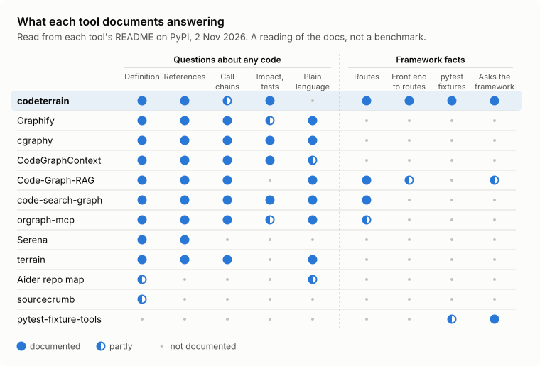

# Prior art: what comparable tools document

A reading of the documentation of twelve tools that give a coding agent structural knowledge of a
code base, set beside codeterrain. It was made on 2 November 2026 from each tool's README as published
on PyPI (and, for Aider, its repo-map page). No tool was installed or run for it, so it records what
each tool says it does, not how well it does it.

<picture>
  <source media="(prefers-color-scheme: dark)" srcset="https://raw.githubusercontent.com/benchli-sports/codeterrain/main/docs/img/prior-art-dark.svg">
  
</picture>

## What it shows

- **The general questions are well covered.** Definitions, references and call chains are documented
  by most of the tools, usually from a tree-sitter graph served over MCP, often with a graph database
  and embeddings. codeterrain does not try to lead there, and does not answer plain-language
  questions at all.
- **No other tool documents pytest fixture resolution.** None says which definition of a fixture a
  test gets, or the setup order. pytest-fixture-tools also asks pytest itself, but lists duplicate
  fixtures and draws a graph per test.
- **No other tool documents reading routes from the application.** code-search-graph, Code-Graph-RAG
  and orgraph-mcp find routes by parsing decorators, so a route registered in code is not seen.
- **One documents a near match to the front-end join.** Code-Graph-RAG links HTTP client URLs to the
  handlers that serve them, across services; its questions are answered through an LLM.

## How it was read

Each cell is one of three values:

- **documented**: the README says the tool answers this kind of question;
- **partly**: it answers a narrower form (a file-level map instead of symbols, a listing instead of a
  lookup, runtime traces instead of the framework's own resolution);
- **not documented**: the README does not say. That is not the same as "cannot", and a tool with
  thin docs is disadvantaged by it.

The columns:

| Column | The question |
|---|---|
| Definition | Where is this name defined? |
| References | Who uses or calls it? |
| Call chains | What does it call, and what calls that? |
| Impact, tests | What does a change reach, and which tests? |
| Plain language | Questions in words, by semantic search or a model |
| Routes | The route table, the handler for a path |
| Front end to routes | A front end's HTTP calls matched to the back-end routes |
| pytest fixtures | Which fixture definition a test gets, and the setup order |
| Asks the framework | Does any answer come from importing the app or running pytest's collection? |

Repomix was also read and left out: it packs a repository into one file for a prompt and answers no
questions.

## What each one needs

| Tool | Languages | A model or key to answer | Storage | Interface |
|---|---|---|---|---|
| codeterrain | Python; JS/TS calls and Terraform with packs | No | SQLite and JSON cache | CLI |
| Graphify | about 40 | Not for code | JSON graph, optional graph database | CLI, skill, hooks, MCP |
| cgraphy | 7 full, 20+ definitions | No | SQLite | MCP, CLI |
| CodeGraphContext | 23 | No | Graph database (FalkorDB Lite, Kuzu or Neo4j) | CLI, MCP |
| Code-Graph-RAG | 13 full, 8 structural | An LLM provider for its queries | Embedded graph and vector store | CLI, MCP, SDK |
| code-search-graph | 5 | No (local embeddings) | SQLite and LanceDB | CLI, MCP |
| orgraph-mcp | not documented | No (local embeddings) | Kuzu | MCP, CLI |
| Serena | 40+ through language servers | No (the client's model drives it) | Language-server processes | MCP, JetBrains plugin |
| terrain | 10 families | An LLM and an embedding provider | Kuzu and a vector store | CLI, MCP |
| Aider repo map | 100+ | Used inside an LLM chat | not documented | Inside Aider |
| sourcecrumb | Python | No | Cache file | CLI, Claude Code hook |
| pytest-fixture-tools | Python (pytest) | No | Graphviz output | pytest options |

The PyPI package `terrain` is a separate project. It installs a `terrain` command, which is why
codeterrain documents `codeterrain` as its command and keeps `terrain` only as a shorter name.

## What would make it a comparison

This page is a reading of documentation. To compare answers, the next step is one fixed question
set on a public repository with a real fixture graph and FastAPI routes, every answer graded against
pytest, the running app and a hand-checked reference, with "declined" and "wrong" scored apart and
install effort, time and tokens recorded beside them.

## Sources

- [codeterrain](https://pypi.org/project/codeterrain/)
- [graphifyy](https://pypi.org/project/graphifyy/)
- [cgraphy](https://pypi.org/project/cgraphy/)
- [codegraphcontext](https://pypi.org/project/codegraphcontext/)
- [code-graph-rag](https://pypi.org/project/code-graph-rag/)
- [code-search-graph](https://pypi.org/project/code-search-graph/)
- [orgraph-mcp](https://pypi.org/project/orgraph-mcp/)
- [serena-agent](https://pypi.org/project/serena-agent/)
- [terrain](https://pypi.org/project/terrain/)
- [Aider's repo map](https://aider.chat/docs/repomap.html)
- [sourcecrumb](https://pypi.org/project/sourcecrumb/)
- [pytest-fixture-tools](https://pypi.org/project/pytest-fixture-tools/)
- [repomix](https://pypi.org/project/repomix/)
