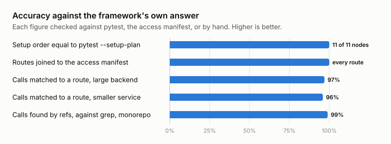
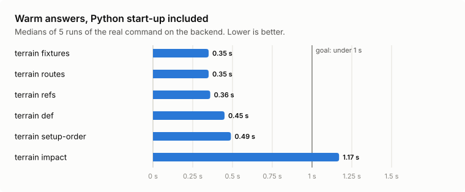
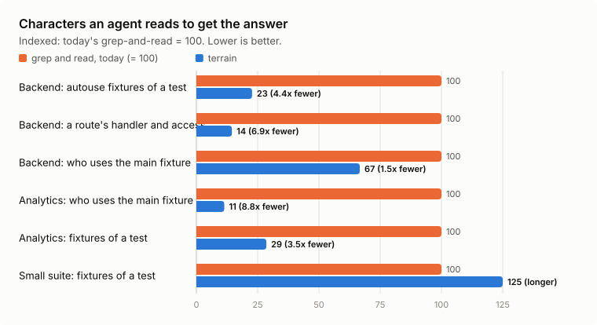

# Why codeterrain exists

## 1. The pain

codeterrain was started inside [benchli](https://www.benchli.com), the team sports platform built by Mitbolas GmbH. Its Python
backend is a large FastAPI service with several apps, a very large test suite and a large shared
`conftest.py`. benchli is developed with coding agents, with separate agents writing and
reviewing.

We measured where the agents' tokens went. Each review round cost hundreds of thousands of tokens, and
most of that went on re-mapping the same structure every session:

- which fixtures exist, and in what order they run for a given test;
- what a route's handler and auth dependencies are;
- which tests to run.

The answers were in the code. An agent could only reach them through many rounds of grep and read. That
hurt in three ways:

- **Tokens and time.** Every round costs both, and every new session paid again for the same facts.
- **Wrong answers.** A grep finds a fixture's name, not pytest's resolution of it. A missed override in
  a nearer `conftest.py`, a session fixture set up earlier than expected, or the wrong auth dependency on
  a route costs a whole review round when a reviewer catches it, and a bug when nobody does.
- **Stale maps.** We tried writing the structure down for the agents. The hand-kept map grew to thousands
  of lines and needed edits almost daily before we cut it back to a pointer. A map that has to be
  maintained by hand is wrong as soon as someone forgets.

## 2. What it is for

The answers should come straight from the code, locally, in under a second, with no LLM in the loop, and
exact enough to trust without checking:

- fixture setup order equal to what pytest's own `--setup-plan` prints;
- route access equal to a route-access manifest that the project's tests already enforce;
- for a front end, the backend route each of its HTTP calls hits.

The tool had to be generic from day one: nothing about benchli in the code, with a project's specifics
only in configuration. That is why it is a separate repository, and why it was tried on other code bases
before anyone relied on it (sections 4 and 5).

Four gains are claimed, and each is measured the same way in every repository:

| Gain | What we measure | How |
|---|---|---|
| **Accuracy** | Does `codeterrain setup-order` give the same fixtures in the same order as pytest? Does every route join the access manifest? Does each front-end call find its route? | `pytest <nodeid> --setup-plan` run in the same sandbox, compared fixture by fixture; the manifest join counted row by row; every unmatched call checked by hand |
| **Speed** | How long a warm query takes | Median of 5 runs of the real `codeterrain` command, Python start-up included |
| **Performance** | How long a cold build takes, and how often it is needed | The `refresh` time per view; the cache is rebuilt only when files change |
| **Tokens** | How much an agent reads to get the answer | Characters of the `codeterrain` answer against the characters of the greps and reads an agent makes for the same question (at 4 characters per token) |

## 3. Where it has to work

codeterrain is meant to serve every repository benchli and Mitbolas GmbH develop with agents, not one
backend. The target list is deliberately balanced across code bases, and not all of them are Python:

| Repository, by shape | Status |
|---|---|
| The benchli backend: Python, FastAPI, several apps, a very large test suite | Proven: all three Python views (section 4), and its front ends joined to its routes (section 5) |
| A benchli device-software repository: older Python, a small pytest suite | Works: fixtures and setup order measured (section 5) |
| Three benchli web front ends: TypeScript | v0.2: calls measured and joined to the backend (section 5) |
| A Mitbolas service: a Python FastAPI back end and JavaScript front ends | Both halves work (section 5) |
| A Mitbolas analytics project: Python, no web framework | Works: fixtures and setup order measured (section 5) |
| A Mitbolas media platform: Python service tests beside a TypeScript front end | Static fixture index and front-end calls; its API is not served by FastAPI, so there are no routes to join |

v0.1 covered the Python halves of these repositories. v0.2 adds the TypeScript and JavaScript front ends:
`codeterrain calls` lists their HTTP calls, and `codeterrain callers`, run in a backend, joins them to its routes
across repositories. 0.3 adds a code index of every Python file, application code and tests alike
(`codeterrain def`, `refs`, `importers`, `imports`, `impact`), and language packs: Terraform's `.tf` files in
`def` and `refs`, and a tree-sitter reader for the front-end calls.

None of these repositories names `codeterrain` in its checked-in agent instructions yet: the agents in
the field used it through a reminder in the developers' own setup. Until one does, the gains
below are what the tool delivers when asked, not what an agent session saves (section 8).

## 4. The benchli backend: from pain to proof

Every figure below was measured on the benchli backend, on a read-only checkout.

| Pain | What codeterrain does | Proof |
|---|---|---|
| Fixture order guessed wrong | `codeterrain setup-order NODEID` collects the suite in a sandbox and reads pytest's own resolution | Equal to `pytest <nodeid> --setup-plan` on 5 of 5 backend nodes, each with about 30 fixtures. The test suite also checks synthetic edge shapes against real pytest |
| Route and auth mapping | `codeterrain routes` and `codeterrain route` import the apps in a sandbox and join each route to the access manifest | Every app imported with no errors. Every route joins to the manifest, with the access class equal on every joined row; the only routes without a row are FastAPI's own documentation routes |
| Slow lookups | A two-tier cache: static facts from `ast`, slow views from sandboxed subprocesses | Warm queries: 0.34 s (`fixtures`), 0.41 s (`routes`), 0.68 s (`setup-order`), medians of 5 runs including Python start-up |
| Tokens spent on grep and read | Short, exact answers | 4.4x fewer characters for the autouse-fixture question and 6.9x for the route question, against the greps and reads an agent makes today. See the note below |
| Is it safe to import the target? | Allowlisted environment, dummy cloud credentials, loopback-only sockets, no writes to the target | Section 6 |

<picture>
  <source media="(prefers-color-scheme: dark)" srcset="img/accuracy-dark.svg">
  
</picture>

<picture>
  <source media="(prefers-color-scheme: dark)" srcset="img/speed-dark.svg">
  
</picture>

Cold builds are slower: seconds for the static fixture index, about a minute and a half for the routes,
and minutes for the setup-order view of the whole suite (measured on a machine shared with another job,
so that figure is inflated). That is why the slow views are cached and served at once, stamped stale
when files move, and rebuilt only by `codeterrain refresh` or `--fresh`.

<picture>
  <source media="(prefers-color-scheme: dark)" srcset="img/tokens-dark.svg">
  
</picture>

**The token figure is characters, not an agent experiment.** We counted the characters of the real
`codeterrain` output against the characters of the greps and reads an agent makes for the same question. The
agent side is a floor: it leaves out reasoning, follow-up reads for ambiguous hits and retries. The third
question we measured, the dependents of the backend's most-used fixture, came out at 1.5x for the
default 2,000-token answer and at 14x if the agent stops after the fixtures, which are the first block
of the answer. A real agent-session A/B, the same backend lane run with and without the tool, has not
been run (section 8).

## 5. Tested beyond the backend

A tool built inside one repository proves little about any other. So we ran it, read-only, on the other
Python repositories in the list above. The same harness ran in each one, with the same three questions:

- **Setup order** for two test nodes, the one with the most fixtures and one from the middle, compared
  with `pytest --setup-plan` run in the same sandbox.
- **Fixtures of a test:** the `setup-order` answer against grepping `@pytest.fixture` and `autouse`,
  with two lines of context, over the test's conftest chain and module. That is the least an agent reads.
- **Dependents of the most-used fixture:** the `codeterrain fixture` answer against `grep -rn` for its name
  over the test paths.

`git status` of every repository was identical before and after each run.

| | Device software | Mitbolas service | Mitbolas analytics | Mitbolas media |
|---|---|---|---|---|
| Parse errors in the static index | 0 | 0 | 0 | 0 |
| Setup order equal to `--setup-plan` | 2 of 2 nodes | 2 of 2 | 2 of 2 | (not run: no environment to import) |
| Routes | - | every app imported, 0 errors | - | - |
| Characters saved, fixtures of a test | 1.3x and 0.8x | 1.3x and 0.8x | 3.5x and 7.8x | - |
| Characters saved, dependents | 2.1x | 1.8x | 8.8x | 0.4x |
| Warm query, idle machine (median of 5) | 0.22 to 0.25 s | 0.28 to 0.31 s | 0.23 to 0.27 s | 0.26 s |
| First setup-order build (one collection) | 2.9 s | 15 s | 7 s | - |

**Accuracy held everywhere:** setup order was equal to pytest's own on 11 of 11 nodes in 4 repositories,
from 2 to about 30 fixtures per node, on Python 3.9 to 3.12 and pytest 8 and 9.

**The token gain scales with the fixture graph.** The analytics project, with a large fixture graph and
one fixture used by well over a hundred tests, saves 3.5x to 8.8x. Repositories with small conftest
chains save little or nothing on a single test, and where a repository has only a couple of fixtures the
answer is longer than the grep. In a small suite the value is the exact order, not the characters: the
grep shows which fixtures exist, not which one pytest picks or in what order they run. We say so rather
than quote the best ratio.

**Speed, measured again on an idle machine:** every warm `fixtures` and `setup-order` answer came
back in a median of 0.22 to 0.31 s across the four repositories, Python start-up included, against a
goal of under 1 s. The first `setup-order` build costs one `pytest --collect-only` of the suite,
about 3 s to 15 s here; later answers come from the cache. The earlier runs, made under heavy load,
had shown 0.3 s to 2.1 s warm. The idle rerun reproduced their accuracy and token figures exactly.

The runs found places where the tool had assumed a repository shaped like the one it was built in. All
are fixed, each with a test:

1. Tests were assumed to live in `tests/` at the root. A repository keeping them elsewhere got an empty
   answer; now `codeterrain doctor` marks `tests (missing)` and `codeterrain fixtures` says so.
2. Nested agent worktrees and virtualenvs under any name were scanned. Now every dot-directory and every
   directory holding a `pyvenv.cfg` is skipped.
3. A project's pytest `addopts` carried coverage options that would have written coverage files into
   the repository. Extraction now switches `addopts` off unless asked, and points `COVERAGE_FILE` into
   the sandbox run directory.
4. The import root was not the repository root. `import_env = { PYTHONPATH = ... }` handles it, and the
   README documents it.
5. Node ids are relative to pytest's rootdir, not to the repository root. The tool uses the ids pytest
   prints.
6. One repository runs Python 3.9. Two calls in the code that runs inside the target (`isinstance` with
   `X | Y`, and `write_text(newline=...)`) need 3.10, and every extraction failed there. A test now keeps
   that code 3.9-safe, and a later review found a third such call in the route walker.

On the backend one more appeared that has nothing to do with layout: Starlette path converters
(`{x:path}`) against a manifest that spells the same route `{x}`. The join now ignores converters.

Four Python code bases of different shapes are a realistic test that the tool helps beyond the one it was
built in. They are not a survey.

### The front ends (v0.2)

`codeterrain calls` ran on the five front ends, and `codeterrain callers` ran from the two FastAPI backends they
talk to. The checkouts were read only.

- **benchli:** across the backend's three front ends, 97% of the calls whose path is written statically
  hit a backend route.
- **The Mitbolas service:** 96% of its front ends' static-path calls hit a route.
- **The Mitbolas media platform:** every call's path was read statically. There are no FastAPI routes to
  join it to.

Every call that hit no route was checked by hand. Nearly all fetch static files the front end serves
itself, or come from a maintenance script. One looked like a real gap: a front end called an endpoint
the backend does not have. It turned out to be the checkout, not the code. That working copy was far
behind its remote's default branch, where the call had already been replaced.

This is the question the join exists to answer, and grep does not answer it. The front end and the
backend name the same parameter differently, and the route prefix sits in a router call in another file.
The case also shows the join's limit: it reads working copies. `codeterrain callers` now warns when a
checkout is behind its upstream or its remote's default branch, or has uncommitted changes.

A few percent of calls build their path in a wrapper or a data provider at run time. They are listed as
unresolved, not dropped, so the coverage is visible.

A cold scan of a front end took under a second, and a rebuild with no changed files took under a tenth of
a second, under the same machine load as the rest of this section.

## 6. Is it safe to point at a repository?

Importing an application can call cloud APIs, and running a repository's collection runs its code. The
trust model is in [SECURITY.md](../SECURITY.md): codeterrain's own process never runs target code, and the
child that does gets an allowlisted environment, dummy cloud credentials, an empty home, git without a
credential helper, a loopback-only socket guard, and pytest's own file-writing options switched off,
so its reports do not land in the repository. These stop accidents, not hostile code, which can
still read and write by absolute path; the import tier is for code you trust.

The evidence, on the backend and on hostile test repositories built for the purpose:

- With a credentials file planted in the home directory, importing the backend apps in the sandbox opened
  nothing in the real home (a Python audit hook recorded every open), and the SDK resolved the dummy key
  from the environment.
- A hostile parent environment (proxy variables, a cloud profile, `PYTEST_ADDOPTS`, a secret token) did
  not reach the child process, and a repository's own config cannot ask for it.
- Against a listener on a non-loopback address, every probe of the socket guard was blocked, and the
  listener saw no connection.
- Nothing is written into the target: extraction passes `-o addopts=` and `-o log_file=`, and the known
  options that write files are refused.

The code has had two whole-repository security reviews and an automated security review on every push, and
every finding shipped with a regression test that fails on the old code. The guard is best-effort
protection against accidental network calls from the code under analysis, not a boundary against hostile
code, and [the sandbox page](sandbox.md) lists each path it does not cover.

## 7. Why not Graphify, or something else

We tried Graphify, code-only, on the benchli backend:

- the build took minutes and produced a very large graph;
- each query took many times longer than grep;
- library symbols are not nodes;
- natural-language queries returned unrelated nodes;
- exact-symbol lookups were accurate, but gave what grep already gives.

We dropped it. That is a statement about that tool on that repository on the day we measured, and nothing
more.

The general difference is in the kind of question. A knowledge graph built by an LLM, or a symbol-level
graph built from the syntax tree, answers "what is near this name". The questions our agents lost tokens
on are runtime questions, where pytest's resolution rules or FastAPI's dependency graph decide the
answer. codeterrain asks the framework itself, in a sandbox, or mirrors its rules statically, and checks
itself against the framework's own output.

By category, without product claims:

- **Symbol indexes** (ctags, language servers) answer definition and reference queries. `codeterrain def`
  and `codeterrain refs` overlap with them on purpose, from a cache and without a running server, and add
  what they do not: each call's argument shape checked against the signature, the places a name is
  patched, and the split between tests and application code.
- **LLM-built knowledge graphs** trade exactness for coverage and cost a model run to build and refresh.
- **Hand-written maps** go stale (section 1).

We have not run a fuller prior-art sweep yet, and this section makes no claim about tools we did not
test.

## 8. What is not proven yet, and what comes next

- **The agent-session A/B on a real backend lane.** The token figures are characters. Until the same lane
  runs with and without the tool, we do not claim a token saving for a whole session.
- **Wiring it in.** No benchli or Mitbolas repository names `codeterrain` in its checked-in agent
  instructions yet; the README has a starting point for them. The A/B and the wiring go together.
- **Next:** the matched route shown from the front-end side; calls whose path a data provider builds
  from a resource name; backends that are not FastAPI; a background process that keeps the indexes
  loaded, if Python's start-up (about a quarter of a second) is worth removing.
- **An MCP wrapper** only after the A/B shows a token gain.
- **A benchmark others can repeat**: the same measurements on a public repository, with the
  commands, revisions and raw outputs published.
